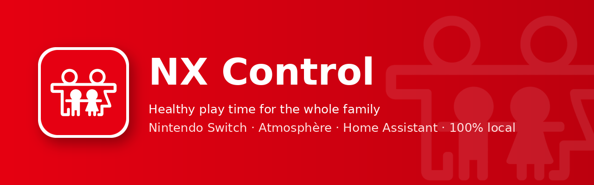
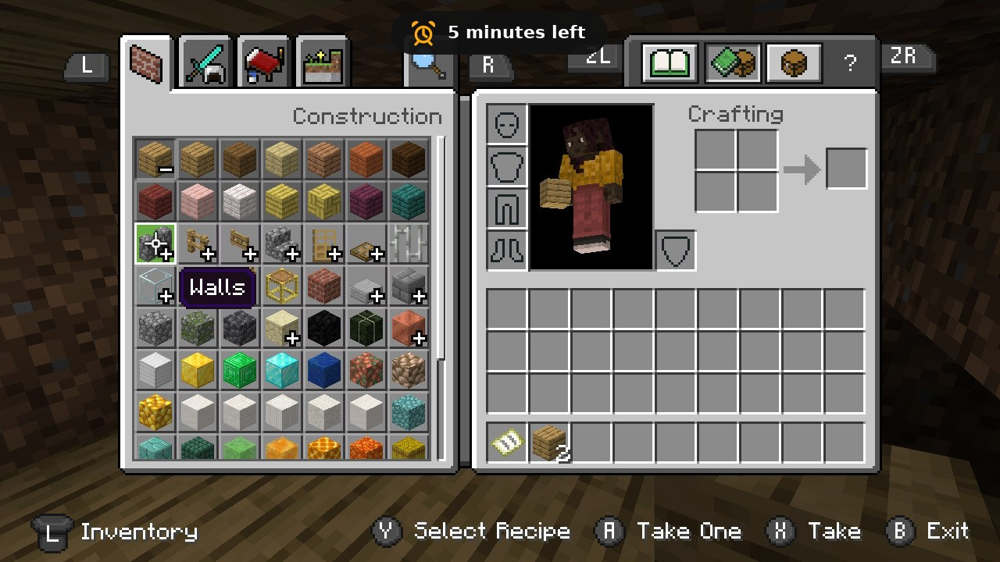
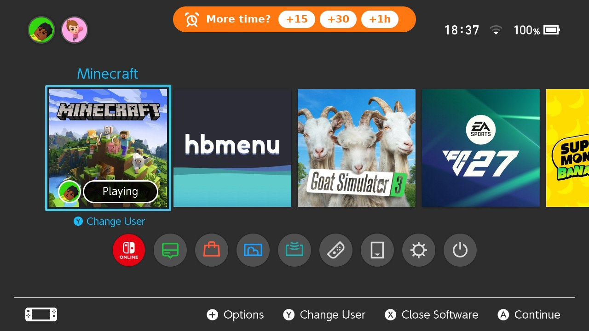
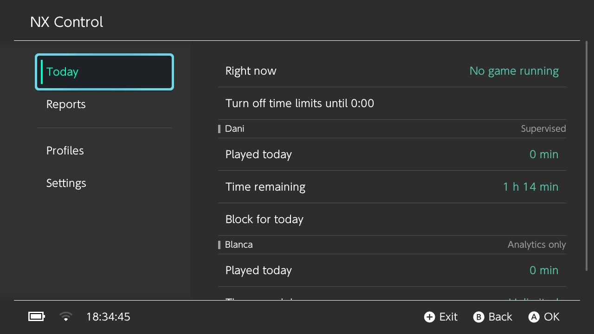
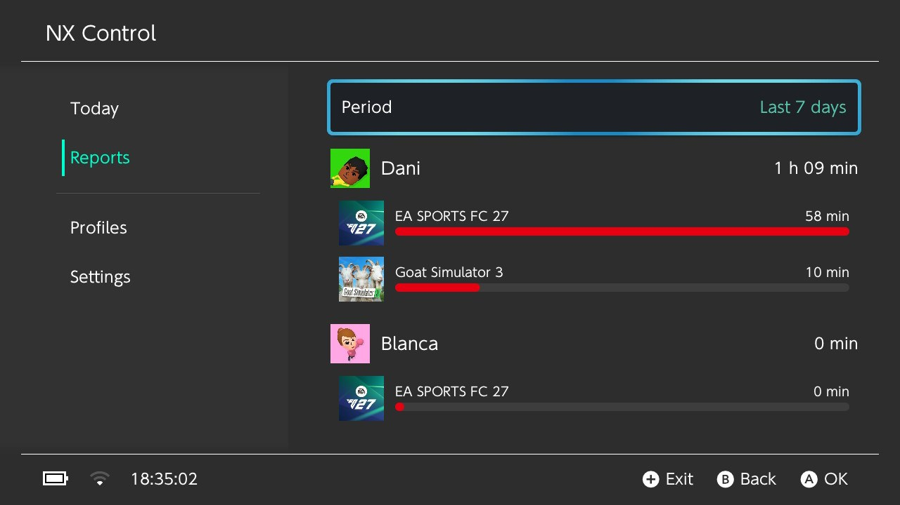
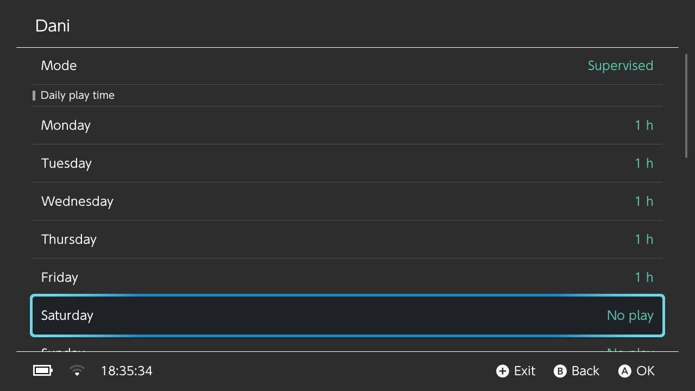
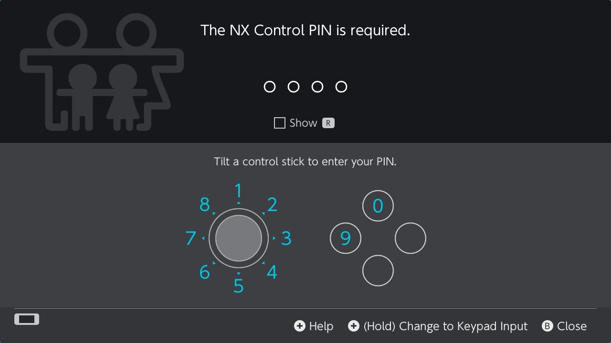
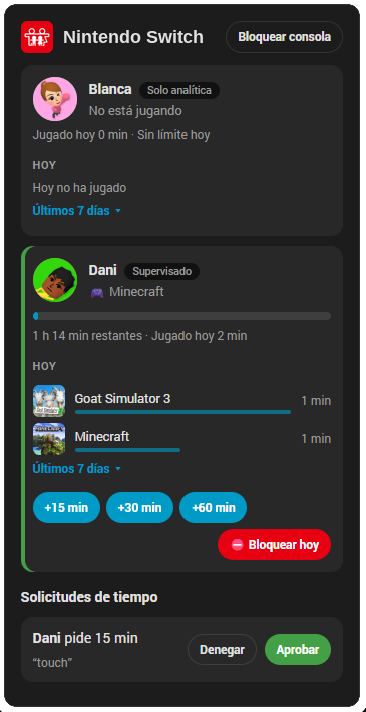
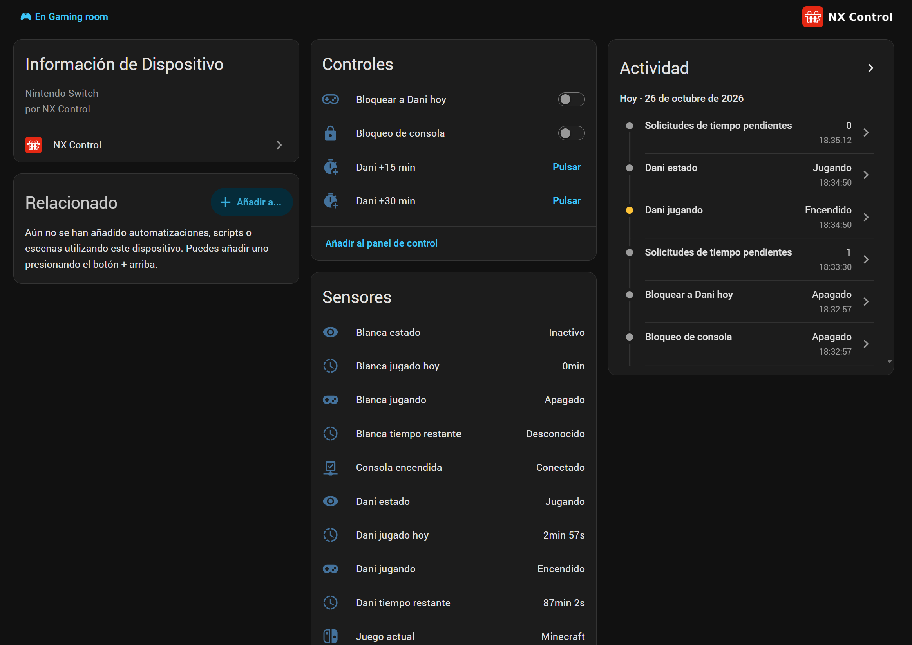

# NX Control

**Healthy play time for the whole family on Nintendo Switch (Atmosphère CFW).**

Local-first · Private · No cloud · No accounts · Free

[**⬇ Download**](https://github.com/danialonso/nx-control/releases/latest) ·
[**📖 Guide (wiki)**](https://github.com/danialonso/nx-control/wiki) ·
[**🏠 Home Assistant**](https://github.com/danialonso/nx-control/wiki/Home-Assistant-Integration)

---

NX Control is a native-feeling time and habit manager for Nintendo Switch consoles running
Atmosphère. It is for everyone: families, teenagers managing their own time, adults building healthy
habits, and smart homes.

## Features

- **Profiles** linked to the console users: *Supervised*, *Self-managed* or *Analytics only*
- **Daily play time** per day of the week, **allowed hours** and **per-game limits**
- **No lost progress**: when time is up the game is sent to HOME and paused, never closed by default
- **On-screen time bar** in the console's style, with a chime at 15, 10, 5 and 1 minutes
- **Ask for more time** from the bar (+15 / +30 / +1 h) and approve it on the console or your phone
- **Block today**, **lock the console** or **no time limits until 0:00**
- **PIN screen** like the console's own (control stick or keypad)
- **Reports** per player and per game, with game icons: today, yesterday, 7 and 30 days
- **Home Assistant** integration (HACS): sensors, actions, phone notifications and a dashboard card
- In **English, Spanish, French, German, Italian and Portuguese**

## Screenshots

<table>
<tr>
<td width="50%"> <b>Time bar</b> while playing, with a chime at 15, 10, 5 and 1 minutes</td>
<td width="50%"> <b>Ask for more time</b> right from the HOME menu</td>
</tr>
<tr>
<td> <b>Today</b>: time left, block for today or no limits until 0:00</td>
<td> <b>Reports</b> per player and per game</td>
</tr>
<tr>
<td> <b>Daily play time</b> for each day of the week</td>
<td> <b>PIN screen</b> like the console's own</td>
</tr>
</table>

<table>
<tr>
<td width="34%" valign="top"> <b>Home Assistant card</b>: extra time, block and time requests</td>
<td width="66%" valign="top"> <b>Home Assistant</b> device with controls and sensors</td>
</tr>
</table>

More in the **[wiki](https://github.com/danialonso/nx-control/wiki)**.

## Install on the console

1. Download `NX-Control-x.y.z.zip` from **[Releases](https://github.com/danialonso/nx-control/releases/latest)**.
2. Extract it to the **root of the SD card** (merge folders).
3. Reboot and open **NX Control** from the Homebrew Menu.

Updating is the same; your settings and statistics are always kept.
Full guide: **[Installation](https://github.com/danialonso/nx-control/wiki/Installation)**.

## Home Assistant (optional)

Or on the console: **NX Control → Settings → Set up Home Assistant** and follow the QR codes.
See the **[Home Assistant guide](https://github.com/danialonso/nx-control/wiki/Home-Assistant-Integration)**.

## Languages

| Language | Console (app, time bar, quick panel) | Home Assistant (integration and card) |
|---|:---:|:---:|
| English | ✅ | ✅ |
| Español | ✅ | ✅ |
| Français | ✅ | ✅ |
| Deutsch | ✅ | ✅ |
| Italiano | ✅ | ✅ |
| Português (Portugal) | ✅ | ✅ |
| Português (Brasil) | 🔜 | 🔜 |
| Nederlands | 🔜 | 🔜 |
| 日本語 | 🔜 | 🔜 |

✅ Included · 🔜 Coming soon

The console follows the **system language** and Home Assistant follows **your profile language**. Any
other language falls back to English; Brazilian Portuguese uses Portuguese (Portugal) for now.

Spotted a wrong translation, or want to add your language? See
**[Languages](https://github.com/danialonso/nx-control/wiki/Languages)**.

## Compatibility

| Console firmware | Status |
|---|---|
| 23.x | ✅ Tested |
| 22.x | ✅ Tested |
| 21.x | ✅ Tested |
| 20.x · 19.x · 18.x | ⚠️ Should work, not tested yet |
| Before 17.x | ❓ Not tested |

| Atmosphère | Status |
|---|---|
| 1.11.x | ✅ Tested |
| 1.12.x | ⚠️ Should work, not tested yet |

Tested it on another version? Tell us in an [issue](https://github.com/danialonso/nx-control/issues)
so we can update the table. More in **[Compatibility](https://github.com/danialonso/nx-control/wiki/Compatibility)**.

## What's new

See the **[changelog](CHANGELOG.md)** for the changes in every version.

## Privacy

No servers, no accounts, no telemetry. Everything stays on your console and your local network.

## License

NX Control is **free** for personal use. You may share the official zip unmodified, free of charge
and crediting the author. Modifying, selling or reverse engineering it is not allowed.
See [LICENSE](LICENSE).

The source code of NX Control is not public, except the quick panel (Tesla overlay) in
[`overlay/`](overlay), which is free software under the GPL. Third-party components:
[THIRD-PARTY-NOTICES.md](THIRD-PARTY-NOTICES.md).

NX Control is not affiliated with or endorsed by Nintendo.
